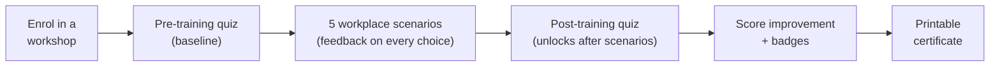
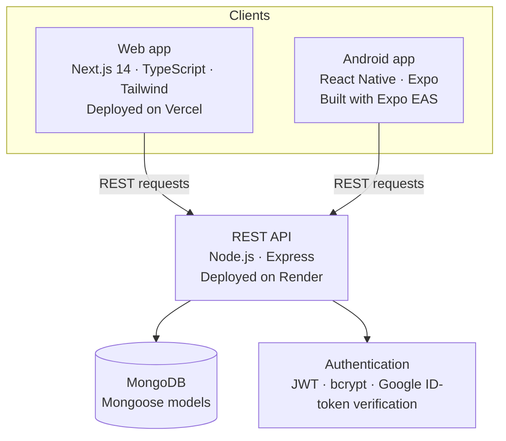
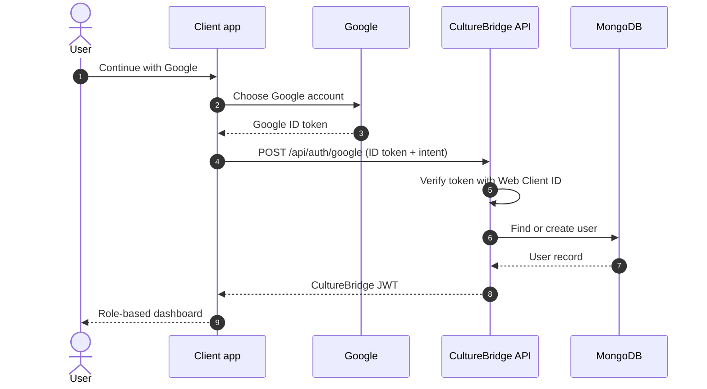

<div align="center">

# 🌍 CultureBridge

### Professional Learning, Cultural Intelligence & Workplace Development Platform

**Plan workshops. Practise real engineering-team situations. Measure what changed.**

*Learn Together · Bridge Cultures · Work Globally*

[](https://culturebridge-one.vercel.app)
[](https://expo.dev/accounts/samarth7272/projects/culturebridge-mobile/builds/0a770050-3676-47a4-95a8-4637394bb2d4)
[](mailto:samarthworldwide@gmail.com)


[TL;DR](#-tldr-for-recruiters) · [Try it](#-try-it-in-2-minutes) · [Features](#-features) · [Architecture](#-architecture) · [Run locally](#-run-it-locally) · [Contact](#-get-in-touch)

</div>

---

## 📌 TL;DR for recruiters

> Cross-cultural friction in distributed teams is rarely about code. It's the silent stand-up, the blunt code-review comment, the 7 a.m. meeting for half the team. CultureBridge turns moments like these into practice scenarios and measures what changed.

- **What it is:** A role-based learning platform (Admin · Trainer · Learner) that covers the whole workshop cycle: create workshop → enrol → pre-quiz → workplace scenarios → post-quiz → certificate.
- **More than a UI demo:** Quiz scoring with per-question review, first-try score and pre/post improvement tracking, gated learning steps, achievement badges, printable certificates and an admin analytics dashboard.
- **End-to-end ownership:** Next.js 14 + TypeScript web app, Node/Express REST API, MongoDB and a React Native (Expo) Android app on one shared backend. Designed, built, deployed and documented by me.
- **Security-minded:** JWT sessions, bcrypt password hashing, Google Sign-In with server-side token verification, role-based access, and admin accounts that can't be created through public sign-up.
- **Product thinking:** Scope, user flows and success measures came from a written PRD with competitor research. Scenarios describe cultural patterns as context, never as rules about a person.
- **See it in 2 minutes:** [Open the live demo](https://culturebridge-one.vercel.app) and follow the [quick tour](#-try-it-in-2-minutes).
- **Hiring?** [Email me](mailto:samarthworldwide@gmail.com) or [connect on LinkedIn](https://www.linkedin.com/in/samarth-shukla-b72003293).

| **3** roles | **5** scenarios | **6** badges | **2** clients | **1** shared API |
| :---: | :---: | :---: | :---: | :---: |
| Admin · Trainer · Learner | Real workplace situations | Unlocked by real progress | Web + Android | One backend for both |

> ⚠️ **Demo notice:** CultureBridge is a working demonstration platform. Some users, workshops, learning activities and results may contain fictional sample data. Learning content is for educational demonstration and should not be treated as legal, HR or professional compliance advice.

---

## 🚀 Try it in 2 minutes



1. Open the **[live demo](https://culturebridge-one.vercel.app)** and sign up as a **Learner** (email or Google).
2. Enrol in a published workshop and take the **pre-training assessment**.
3. Work through the **five workplace scenarios**. Every choice gets outcome-specific feedback.
4. Take the **post-training assessment**, then check your **score improvement** and **badges**.
5. Open and print your **learning certificate**.

> **Want to see the Admin or Trainer side?** Sign up as a **Facilitator** to explore the trainer workspace. Admin access is protected by design (it can't be created through public sign-up), so [email me](mailto:samarthworldwide@gmail.com) and I'll share a demo admin login.

📱 **On Android?** Open the [Expo build page](https://expo.dev/accounts/samarth7272/projects/culturebridge-mobile/builds/0a770050-3676-47a4-95a8-4637394bb2d4), select the successful Android build, download the APK and install it.

💡 **Tip:** If the first sign-in takes a few seconds, the API is waking up from idle on Render. It's quick after that.

<!--
## 📸 Screenshots

Add your images to docs/screenshots/ and uncomment this block.

| Learner journey | Scenario feedback | Admin analytics |
| --- | --- | --- |
|  |  |  |
-->

---

## 🎯 What this project demonstrates

| Skill area | Evidence in this project |
| --- | --- |
| **Full-stack development** | Next.js 14 (App Router) + TypeScript front end, Express REST API, MongoDB with Mongoose |
| **Authentication & security** | JWT sessions, bcrypt hashing, server-side Google ID-token verification, role-based access control, no admin creation via public sign-up |
| **Mobile development** | React Native + Expo Router Android app on the same backend, with native Google Sign-In and light/dark themes |
| **API design** | Route modules for auth, users, workshops, progress and organisations; separate `signin` and `signup` intents on the Google endpoint |
| **Business logic & state** | Quiz scoring, gated learning steps, progress tracking, badges and certificates (see `lib/`) |
| **Data visualisation** | Recharts admin dashboard: registrations over time, registered vs completed |
| **Deployment** | Three independent targets: Vercel (web), Render (API), Expo EAS (Android) |
| **Product thinking** | PRD-driven scope, scenario design that treats culture as context, outcome-based feedback |

---

## ✨ Features

### 🎓 Employee / Learner

- Browse, enrol in and leave published workshops.
- **Pre-training assessment** (5 questions, one attempt) sets a baseline.
- **Five interactive workplace scenarios** with outcome-specific feedback, a practical takeaway and retry.
- **Post-training assessment** that unlocks after the pre-quiz and all scenarios, with retake and per-question review.
- Progress tracking with first-try score and pre/post score improvement.
- **Achievement badges** that unlock from real progress.
- **Printable certificate** with an editable name, both scores and the issue date.

**The five scenarios**

1. The Silent Stand-up
2. Direct Code Review Comment
3. Meeting at 7 a.m. for Half the Team
4. Talked Over on a Client Call
5. A Name That Keeps Being Shortened

### 🧑‍🏫 Facilitator / Trainer

- Pick a published workshop and mark attendance per participant.
- Live present count, saved between visits.
- Monitor participant progress and support learner activities.

### 👨‍💼 Admin

- Stat cards and interactive charts: registrations over time, registered vs completed.
- Create, publish, unpublish and delete workshops with validated forms.
- Registration and completion tracking, plus an upcoming-workshops list sorted by date.
- One-click CSV export of workshop data.
- User and organisation management according to assigned permissions.

### 📱 Android app (React Native + Expo)

- Same backend and authentication as the web app.
- Email and password sign-in, plus Google account selection, Sign-In and Sign-Up.
- Learner and facilitator registration with role-based dashboard navigation.
- Light and dark themes.

---

## 🧩 Architecture



The web and Android apps talk to the same REST API. The API owns authentication, application logic and all database access.

---

## 🔐 Security and engineering highlights

- **One backend, two clients:** the web app and the Android app share the same REST API and authentication, and deploy independently.
- **Privilege-escalation guard:** public registration can only create Learner or Facilitator accounts. Admin access is managed separately, and existing roles are preserved during Google Sign-In.
- **Server-side Google token verification:** the API verifies every Google ID token (`google-auth-library`) against the configured Web Client ID, supports separate `signin` and `signup` intents, and links Google logins to existing accounts instead of creating duplicates.
- **Credentials handled properly:** bcrypt-hashed passwords, JWT-based sessions, and secrets kept in environment variables, never in the repo.
- **Honest about gaps:** a production rollout would add security testing, monitoring and a full review of role-based API permissions (see the roadmap).

**Google Sign-In flow**



---

## 🛠️ Tech stack

| Layer | Technologies |
| --- | --- |
| **Web frontend** | Next.js 14 · React 18 · TypeScript · Tailwind CSS · Recharts · Lucide React |
| **Backend** | Node.js · Express.js · Mongoose · JWT · bcryptjs · google-auth-library · dotenv · CORS |
| **Database** | MongoDB |
| **Mobile** | React Native · Expo · Expo Router · TypeScript · Google Sign-In |
| **Deployment** | Vercel (web) · Render (API) · Expo EAS (Android) |
| **Tooling** | Git & GitHub · VS Code |

---

## 💻 Run it locally

<details>
<summary><b>Setup: web app, API and mobile (click to expand)</b></summary>

<br>

**Prerequisites:** Node.js 18.17 or newer, npm, Git and a MongoDB connection string (VS Code recommended).

**1. Clone and install the web app**

```bash
git clone https://github.com/Samarth7272/culturebridge.git
cd culturebridge
npm install
```

**2. Configure and start the web app**

Create a `.env.local` file in the project root if your setup needs it:

```dotenv
NEXT_PUBLIC_API_URL=YOUR_BACKEND_API_URL
```

```bash
npm run dev
```

Open `http://localhost:3000`.

**3. Configure and start the backend**

```bash
cd backend
npm install
```

Create a `.env` file inside `backend/` with your own credentials. Never commit `.env` files or secrets to GitHub.

```dotenv
PORT=5000
MONGO_URI=YOUR_MONGODB_CONNECTION_STRING
JWT_SECRET=YOUR_SECRET_KEY
CLIENT_URL=YOUR_FRONTEND_URL
GOOGLE_WEB_CLIENT_ID=YOUR_GOOGLE_WEB_CLIENT_ID
OPENAI_API_KEY=YOUR_OPENAI_API_KEY
```

```bash
npm start
```

The API runs on `http://localhost:5000`.

**4. Mobile app (separate Expo project)**

The React Native + Expo app is maintained in a companion project. Its environment needs:

```dotenv
EXPO_PUBLIC_API_URL=YOUR_BACKEND_API_URL
EXPO_PUBLIC_GOOGLE_WEB_CLIENT_ID=YOUR_GOOGLE_WEB_CLIENT_ID
```

Native Google Sign-In needs an Android development or production build. Expo Go alone is not enough.

</details>

<details>
<summary><b>API reference: authentication routes</b></summary>

<br>

| Method | Endpoint | Purpose |
| --- | --- | --- |
| POST | `/api/auth/register` | Register with email and password |
| POST | `/api/auth/login` | Log in with email and password |
| POST | `/api/auth/google` | Google Sign-In and Sign-Up |

The Google endpoint accepts two intents: `signin` (authenticate an existing CultureBridge user) and `signup` (create a new learner or facilitator account). The backend verifies the Google identity token before creating or authenticating anyone.

Other route modules in `backend/routes/`: `users`, `workshops`, `progress`, `organisations` and `ai`.

</details>

<details>
<summary><b>Project structure</b></summary>

<br>

The repository contains the web app and the backend API. The companion mobile app lives in a separate Expo project.

```text
culturebridge/
│
├── app/
│   ├── page.tsx
│   ├── admin/
│   ├── facilitator/
│   ├── learner/
│   ├── layout.tsx
│   └── globals.css
│
├── components/
│   ├── Nav
│   ├── DashboardLayout
│   ├── Globe
│   └── Other UI Components
│
├── lib/
│   ├── data.ts
│   ├── score.ts
│   └── useStore.ts
│
├── backend/
│   ├── models/
│   │   └── User.js
│   │
│   ├── routes/
│   │   ├── auth.js
│   │   ├── users.js
│   │   ├── workshops.js
│   │   ├── progress.js
│   │   ├── organisations.js
│   │   └── ai.js
│   │
│   ├── server.js
│   ├── package.json
│   └── package-lock.json
│
├── public/
├── package.json
├── package-lock.json
├── next.config.mjs
├── postcss.config.mjs
├── tailwind.config.ts
├── tsconfig.json
└── README.md
```

</details>

<details>
<summary><b>Evaluation checklist: auth, roles and the learning journey</b></summary>

<br>

**Authentication**

- Register using an email and password.
- Log in using an existing account.
- Create an account using Google, then sign in using Google.
- Verify that an existing account is not duplicated.
- Test logout and subsequent login.

**Role-based dashboards**

- Test administrator, facilitator and learner access.
- Verify that each account reaches the appropriate dashboard.

**Learning journey**

1. Open the learner workspace.
2. Enrol in a published workshop.
3. Complete the pre-training assessment.
4. Attempt the five workplace scenarios and review the feedback for each selection.
5. Complete the post-training assessment.
6. Review progress and achievement badges.
7. Open and print the learning certificate.

</details>

---

## 🗺️ Roadmap

- [ ] Automated unit and end-to-end testing.
- [ ] Production monitoring and performance optimisation.
- [ ] Advanced analytics for administrators.
- [ ] Expanded facilitator tools and reporting.
- [ ] Automated email and push notifications.
- [ ] More interactive learning assessments.
- [ ] More professional learning programmes and workshop categories.
- [ ] Improved mobile application functionality.
- [ ] Google Play Store publication.

---

## 🤝 Get in touch

**Samarth Shukla** · Final-year B.Tech Computer Science & Engineering (batch of 2027)

I build full-stack products end to end, from the UI and REST APIs to authentication, mobile apps and deployment. I'm open to software engineering internships and full-time roles, and I'd be happy to walk you through the code, the architecture decisions or a live demo.

[](mailto:samarthworldwide@gmail.com)
[](https://www.linkedin.com/in/samarth-shukla-b72003293)
[](https://github.com/Samarth7272)
[](https://culturebridge-one.vercel.app)

---

<div align="center">

**🌍 CultureBridge** · Learn Together · Bridge Cultures · Work Globally

*Building a better-connected professional learning experience.*

</div>
